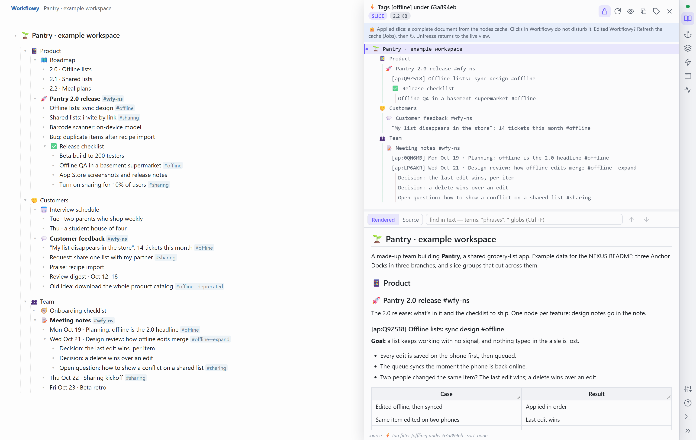
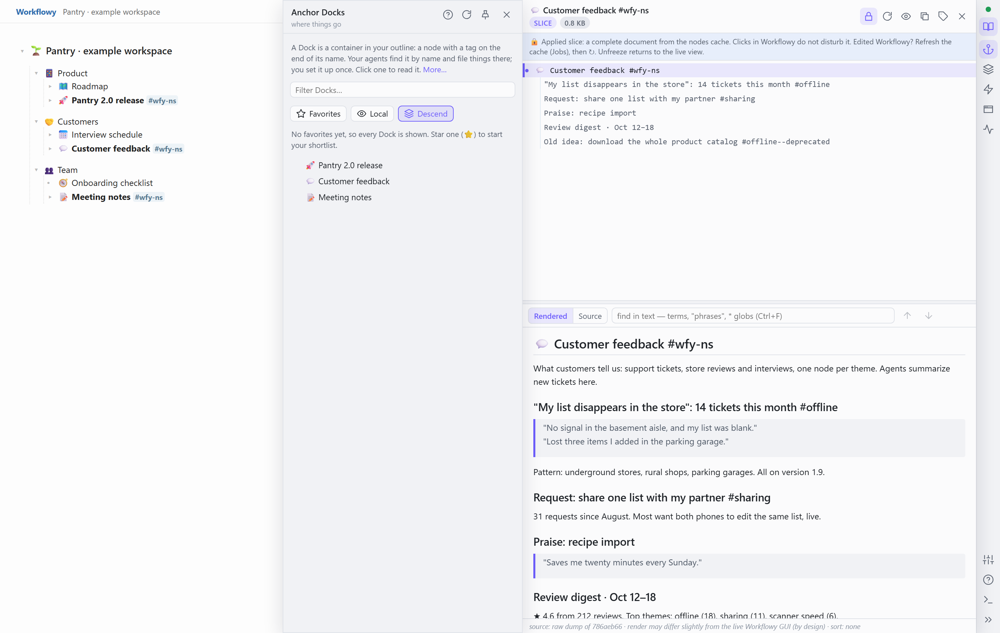
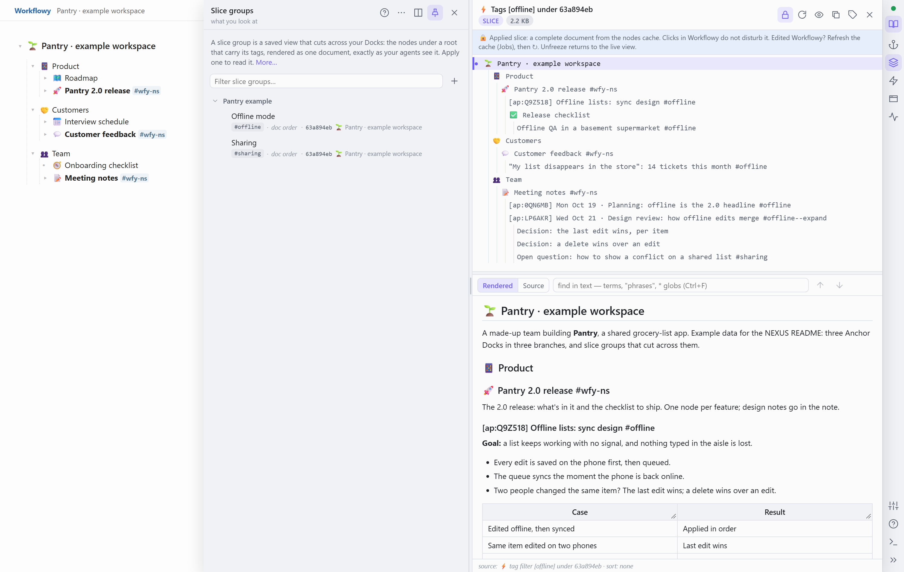
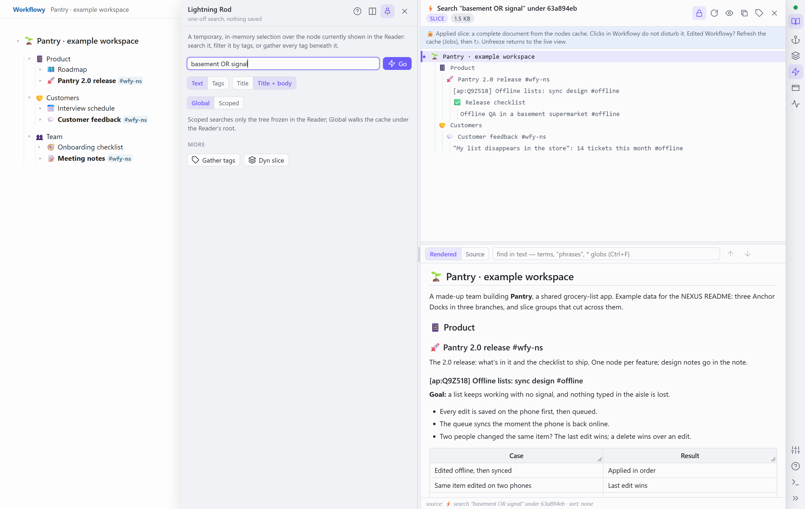
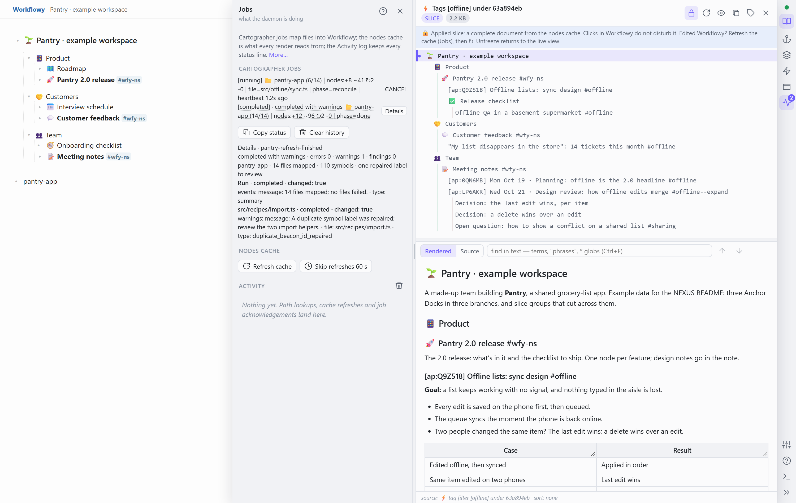
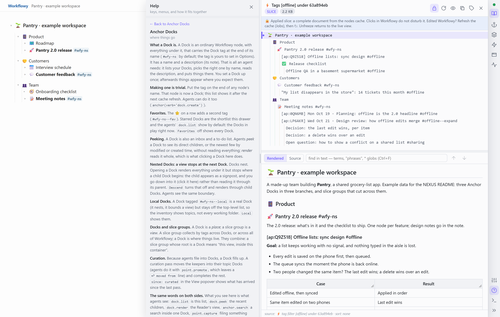
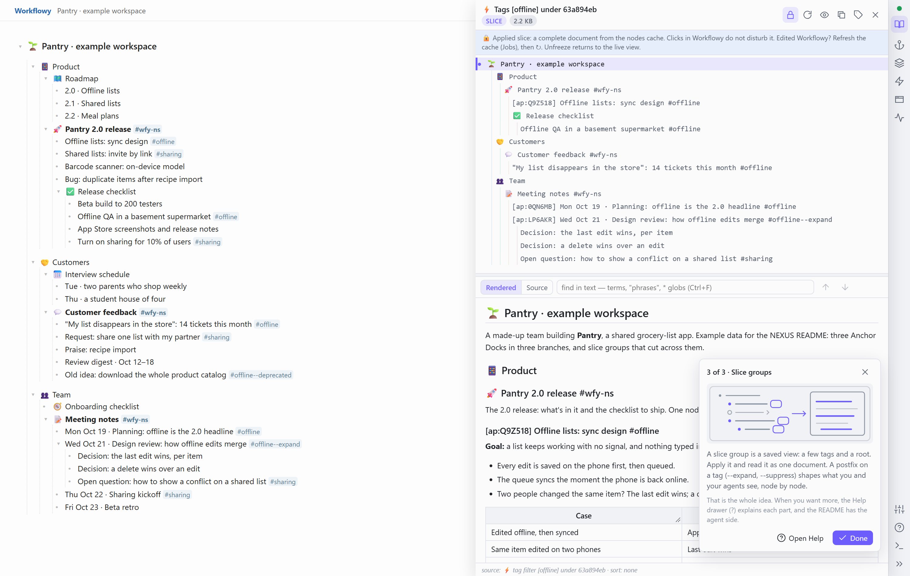

> **Public snapshot, 2026-10-28.** A point-in-time copy of an actively developed private repository; its commit history is omitted. Install instructions are still being written; expect rapid change over the coming weeks.

# NEXUS

**Workflowy context management, with your agents.**

NEXUS is a Workflowy-native context-management system for agents and humans working together. [Workflowy](https://workflowy.com), the outliner, is the single shared canvas — projects, decisions, communications, notes — and source code is mapped live onto it from disk by Cartographer. The agent reads and writes the same tree the human sees: no copies, no exports, no drift.

<picture>
  <source media="(prefers-color-scheme: dark)" srcset="docs/readme/readme-hero-dark.png">
  
</picture>

*The example used throughout this page: a made-up team building **Pantry**, a shared grocery-list app. Left, Workflowy, with three Anchor Docks in three separate branches: 🚀 Pantry 2.0 release, 💬 Customer feedback and 📝 Meeting notes. Right, the Reader: every node tagged `#offline`, from all three Docks, as one document, which is exactly the Markdown an agent gets from `glimpse`. The design review tagged `#offline--expand` brings its decisions along; the old idea tagged `#offline--deprecated` stays out.*

<sub>Every screenshot shows the extension's real, current UI on real NEXUS output, captured headless beside a stand-in Workflowy page. [How they are made.](docs/readme/README.md)</sub>

> **Human:** you never describe context; you point at it.
>
> **Agent:** you never guess context; you look.

NEXUS is an MCP server, a code mapper and a Chrome extension that turn one Workflowy outline into the shared, visible memory of a person and the agents working for them. Half of it serves knowledge work, half serves source code, and both live in the same tree. Point any MCP-capable agent at it (Claude Code, OpenCode, anything that speaks MCP) and it gets eight tool families for reading, filing, slicing and mapping that tree. Because every session works in the one outline you can watch, the NEXUS MCP tooling provides an outstanding substrate for true scaling agentic swarm management.

**On this page:** [What you see, your agent sees](#what-you-see-your-agent-sees) · [Anchor Docks](#anchor-docks) · [Slice groups and postfixes](#slice-groups-and-postfixes) · [Source code](#source-code-cartographer-and-beacons) · [Why Workflowy](#why-workflowy) · [One tree, many agents](#one-tree-many-agents) · [The tools](#the-tools-eight-families) · [The Rail](#the-rail-a-live-readme) · [Install (preview)](#install-preview) · [Status](#status-and-honest-limits)

## What you see, your agent sees

An agent can see whatever you are looking at in Workflowy, at any moment.

Zoom into a bullet. Expand what matters, collapse what doesn't, search if you like. Then say "GLIMPSE this." The agent calls `glimpse(verb='run')` and reads exactly that view (your zoom, your expansions, your filter) as one clean Markdown document. Nothing is copied or pasted, and there is no file path to give. What you see, it sees. That bare core needs nothing else: no Docks, no slice groups, no setup.

It works the other way too. The extension docks a **Reader** beside your outline (*what your agent sees, rendered*): click any node in Workflowy and it appears there as one document, the same render your agents get. An agent can put any view in front of you (`push_to_modal: True`), and `render_spec: 'modal'` hands the agent exactly what your Reader shows. You and your agents point at the same thing, from either side.

### The agent side

The hero's right-hand document, as an agent receives it: the actual call, and the first lines of what it returned ([the whole document](docs/readme/example/offline-mode.md)).

```python
glimpse(verb='run', params={
    'render_spec': {'tags': ['offline'], 'root': '63a894eb'},
    'headings_only': False,
})
```

```markdown
# 🌱 Pantry · example workspace

A made-up team building **Pantry**, a shared grocery-list app. Example data for the NEXUS README: three Anchor Docks in three branches, and slice groups that cut across them.

## 📱 Product

### 🚀 Pantry 2.0 release #wfy-ns

The 2.0 release: what's in it and the checklist to ship. One node per feature; design notes go in the note.

#### [ap:Q9Z518] Offline lists: sync design #offline

**Goal:** a list keeps working with no signal, and nothing typed in the aisle is lost.

- Every edit is saved on the phone first, then queued.
- The queue syncs the moment the phone is back online.
- Two people changed the same item? The last edit wins; a delete wins over an edit.

| Case | Result |
|---|---|
| Edited offline, then synced | Applied in order |
| Same item edited on two phones | Last edit wins |
| Deleted on one phone, edited on the other | Deleted |

Agreed in the design review [ap:LP6AKR].
```

It goes on through 💬 Customer feedback and 📝 Meeting notes. Workflowy's nesting becomes the heading levels, each node's note becomes its body, and Anchor Points like `[ap:LP6AKR]` become citations an agent can follow. `63a894eb` is the first segment of the workspace root's UUID: every tool takes that, a full UUID or an Anchor Point handle, interchangeably.

## Anchor Docks

*where things go*

A Dock is a container in your outline: a node with a tag on the end of its name. Your agents find it by name and file things there; you set it up once.

It has a name and a description (its note). That is all an agent needs: it lists your Docks, picks the right one by name, reads the description, and puts things there. You never have to tell an agent where something goes. **Making one is trivial:** put the Dock tag (`#wfy-ns` by default, yours to change) on the end of any node's name, or ask an agent to (`anchor(verb='dock.create')`).

A Dock is also an inbox and a to-do list: agents *peek* at its direct children, or just the newest few, without reading everything, and *render* it to read it whole. Docks nest, and a view stops at the next Dock, where the child appears as a signpost you step into. Star the Docks in play (⭐) and they become the shortlist you and your agents see first.



*The Anchor Docks drawer lists the example's three Docks. Clicking 💬 Customer feedback renders it in the Reader: the same document `anchor(verb='dock.render')` returns to an agent.*

**The same words on both sides.** What you see in the drawer is what agents see: `dock.list` is the list, `dock.peek` the recent children, `dock.render` the Reader's view, `anchor.search` a search inside one Dock, `point.capture` filing something there. The names match on purpose.

**Anchor Points.** Any node can carry a permanent citation handle at the front of its name, like `[ap:Q9Z518]`, that survives renames, moves, sorting and completion. Every tool accepts one wherever it asks for a node, so a decision one agent cites today, another can open next month. In the example, the sync design cites the design review that agreed it, and the review cites it back.

**A node is a file.** A note can hold a whole Markdown document, and the node tools work the way agents already work with files:

| With files | With NEXUS |
|---|---|
| write a file | `anchor(verb='point.capture')`: a new node, filed where it belongs |
| read it, or a window of its lines | `node(verb='read')`, with `offset` and `limit` |
| grep | `node(verb='search')`: numbered hits with context, in one note or a whole subtree |
| edit by search and replace | `node(verb='edit')`, which answers with a diff of what changed |
| move, archive | `node(verb='move')`, `node(verb='export')` |

Anchor Docks are where things go; slice groups are what you look at. Your set of Docks becomes the state of your world: a living record rather than a lost chat log.

## Slice groups and postfixes

*what you look at*

A slice group is a saved view that cuts across your Docks: the nodes under a root that carry its tags, rendered as one document, exactly as your agents see it.

**Start simply.** One tag, no root. Tag three nodes `#topic`, make a group with the tag `topic`, Apply. That already works, and it is what most groups are.

**The power is in the postfixes.** Add a word after a tag with two hyphens and the same tag starts to shape the view: `#topic--expand` marks what opens, `#topic--suppress` folds a subtree out of the view, `#topic--deprecated` keeps a node in the family but drops it from the default view. Tags are matched as prefixes, so `#topic-anything` is still a member. This is how you control what agents see, node by node, with no code: an agent asking for the group gets exactly this view.

**In the example,** `#offline` sits on nodes in all three Docks: the sync design and a QA task in the release, the "my list disappears in the store" tickets in customer feedback, the planning meeting in the meeting notes. The design review carries `#offline--expand`, so its two decisions and its open question come along. An old idea carries `#offline--deprecated` and drops out. One view renders all of it, in document order, as the hero shows. The material stays in place; what you look at changes.



*The Slice groups drawer, pinned beside the Reader: each group is a few tags, a sort and a root, filed under a category. The two entries here were staged for the screenshot; the document beside them is the real `#offline` render.*

An agent's `glimpse(verb='run', params={'group_handle': …})` returns the same document you see, and `push_to_modal` puts it in your Reader. A view doesn't even need saving: a tags-and-root pair, like the call in [the agent side](#the-agent-side), is an unnamed slice group with the same postfix rules. Beyond that, a **lens** combines groups, inline tags and plain subtrees by union, intersection or difference without saving anything (`slice_group(verb='render')`), and `slice_group(verb='sift')` searches only inside one. `recent` narrows any view to the latest work: the ten newest items (`'last 10'`), or a twelve-hour window ending at the newest item in the view (`'12h'`).

Curate the thinking once; reuse it all week. A slice is a snapshot of a decision you already made, not a query you re-run every morning.

### The Lightning Rod

*one-off search, nothing saved*

A slice group is the tidy garage you come back to. The Lightning Rod is a day's work on the bench: a search or a tag filter beneath the Reader's current root, rendered like a slice but kept nowhere. Agents have the same bench in `lightning_rod`: a search (boolean, globs or regular expressions), a tag filter, or a hand-picked list of nodes or functions, rendered and then forgotten.



*A one-off search for `basement OR signal` across the example. An agent gets the same document from `lightning_rod(verb='render_search', params={'root_handle': '63a894eb', 'query': 'basement OR signal', 'headings_only': False})`.*

## Source code: Cartographer and beacons

The other half of NEXUS is for code.

A **beacon** is a comment block you write into a source file. **Cartographer** reads the repository on disk and reflects it into Workflowy as a mapped subtree: one node per file and, for Python, JavaScript, TypeScript and Vue, one per function and class; each beacon's labels become `#tags`. Workflowy holds a map of the code, refreshed from disk: the source of truth never leaves the repository. You don't adopt a tracker or a database. You add comments to code, and those comments become a map any agent can read.

```python
# @beacon[
#   id=pantry@merge_offline_edits,
#   slice_labels=pantry-sync,
#   kind=ast,
#   comment=Applies queued offline edits to a shared list: the last edit wins per item; a delete wins over an edit.,
# ]
def merge_offline_edits(list_id: str, queued: list[Edit]) -> ShoppingList:
```

<sub>An illustrative beacon, in the example's world.</sub>

A **beacon slice** is everything that carries a label, rendered as one document: each function's signature and its beacon comment, without the bodies. It is a table of contents with intent, assembled deterministically from disk with no model in the loop. Even a very large file becomes a short document an agent reads in one pass, after which it knows exactly which symbol to open. `beacon(verb='snippet')` then reads that function live from disk by name, with file line numbers, ready to edit; every function and class in the map resolves by name, beaconed or not.

Because a slice is built from the code itself, it doesn't drift the way separate documentation does: it is the source code. Agents write beacons in the same edit as the code, and the next refresh carries them into the map. The rule is **curate, don't carpet-bomb**: beacon nothing and slices rot; beacon everything and a slice that contains everything curates nothing.

Beacon slices complement RAG and LSP rather than replace them. RAG retrieves by similarity to a query; a beacon slice retrieves by location (the comment sits at the function) and by salience someone wrote down, deterministically, with zero tokens to assemble. Code becomes its own documentation and its own task surface: a beacon slice is the to-do list for agents, for people. With `repository_view: True`, a slice renders as clean Markdown you could commit.

Refreshes run as jobs inside the daemon, paced and cancellable, and the Jobs drawer (*what the daemon is doing*) shows them; in Workflowy, Ctrl+F12 on a file or folder node opens the Cartographer menu. Disk is truth: mapped code is edited on disk, and the next refresh brings Workflowy up to date.



*The Jobs drawer: one Cartographer refresh running, with Cancel; one finished with a warning, its Details open. The job records are invented for an imaginary `pantry-app` repository; the drawer is the real one.*

The method also works without Workflowy: `agent-kit/` holds `code-map`, a standalone skill with beacon blocks, a catalog of the repository's labels and generated Markdown slices, needing nothing but Python and git. It is in the repository now; its own release is en route.

## Why Workflowy

Sometimes the constraints are as powerful as the flexibility. A file system can store anything, and that is its problem: it is too powerful to manage. Workflowy is one document.

With a folder of Markdown files, you can't just click the folder and read every document inside it as one page; in Workflowy, that is simply what a subtree is. Tags filter that one document without creating a new one. The order is yours, not alphabetical or by date. Restructuring (indent, outdent, move) takes a fraction of a second. And you can't separate the store from the way people see it: the outline is the data and the view at once, so every map, slice and Dock is something a person can look at, not a table behind an app.

Context management is the foundational challenge of working with agents: the relevant material, not too much and not too little. In a node-based, tag-based outline, nodes are units of memory, and only a certain subset of them is relevant at any given time. A tag marks one node (a decision, a ticket, a paragraph) rather than a whole file, and a slice gathers exactly those nodes from across the outline without moving them. Thousands of nodes in Workflowy is par for the course, and a sign of a good system; thousands of Markdown files is a sprawl.

Picture the nodes as points in space. A set of them lights up for one agent, another set for the next: little dots of light, lighting up and vanishing. That is context management. With files, the smallest thing that can light up is a whole file.

If Workflowy didn't exist, it would have to be invented.

## One tree, many agents

Every agent session works in the same outline. That is what makes NEXUS a substrate for swarms rather than one assistant's memory:

- **One daemon, every session.** Each MCP host (Claude Code, OpenCode, any MCP client) attaches to the one NEXUS daemon and sees the same tree, the same Docks and the same views.
- **Every tab, addressable.** One local broker reaches the extension in every Workflowy tab. Give a tab an alias (*name this tab for your agents*) and agents address it as `target_tab`.
- **Governed writes.** Writes to Workflowy are paced account-wide, and a batch that meets an uncertain write stops instead of guessing. Cartographer runs as governed jobs you can watch and cancel.
- **Hand-offs by handle.** Anchor Points cite across sessions: in an agentic loop, the anchor is what survives the fork. A Dock is an inbox, and `dock.peek` with `recent` shows what arrived or changed last; `point.touch` sets a working order; `point.promote` moves the keepers into their topic Docks, each with a trail line saying where it came from; `node.export` archives stay readable after they leave the outline.
- **Visible.** Each agent's working set is a handful of dots of light in one outline you can watch.

## The tools: eight families

**The tool descriptions are the skill.** You don't need a skill file to start: load the tools and an agent reads its way in. One call gives the whole map; each cheap peek sharpens it; the descriptions themselves route the agent.

Every call is `family(verb='…', params={…})`. `describe` returns any verb's full documentation, and a failed call comes back with that verb's documentation attached. Handles are interchangeable everywhere: a full UUID, its first 8 hex characters (`63a894eb`), or an Anchor Point (`[ap:Q9Z518]`).

| Tool | For | Verbs |
|---|---|---|
| `glimpse` | Rendering: what you have open, the Reader, a node, a Dock, a saved view, or several at once | `run` · `estate` |
| `anchor` | Anchor Docks and Anchor Points | `dock.list` · `dock.peek` · `dock.render` · `dock.get_description` · `dock.create` · `dock.update` · `dock.promote` · `dock.demote` · `point.capture` · `point.read` · `point.extract` · `point.promote` · `point.touch` · `point.assign_id` · `point.remove_id` · `point.resolve` · `search` |
| `node` | Any node as a file: read, grep, edit, move | `read` · `search` · `edit` · `append_note` · `prepend_note` · `etch` · `move` · `complete` · `uncomplete` · `delete` · `export` · `scry` · `ancestors` · `resolve` · `update_emoji` · `prepend_emoji` · `append_emoji` |
| `tag` | Trailing `#tags`, on one node or in batches | `add` · `remove` · `rename` · `batch` · `purge.preview` · `purge.apply` |
| `slice_group` | Saved views and lenses | `list` · `get` · `create` · `update` · `delete` · `render` · `sift` · `merge.render` · `merge.persist` · `purge.preview` · `purge.apply` |
| `lightning_rod` | One-off selections | `gather` · `render_tags` · `render_search` · `render_symbols` · `render_nodes` |
| `beacon` | Mapped source code | `snippet` · `resolve` · `check` · `fix` · `tags.ensure` · `tags.remove` · `sync_node` · `map.refresh` |
| `system` | Health, cache, jobs, archives | `ping` · `broker.status` · `config.get` · `cache.refresh` · `job.status` · `job.cancel` · `archives.list` · `archives.mount` |

Eight tools, 74 verbs, and a `describe` on each tool. Five calls cover a first session:

| You want | The call |
|---|---|
| what I have open | `glimpse(verb='run')` |
| my Docks | `anchor(verb='dock.list')` |
| file this | `anchor(verb='point.capture', params={…})` |
| a view across Docks | `glimpse(verb='run', params={'group_handle': …})` |
| a function, by name | `beacon(verb='snippet', params={'source_handle': …})` |

## The Rail: a live README

> Everything NEXUS adds to Workflowy lives in this rail. Click any node to read it in the Reader. The icons open your Anchor Docks, slice groups, the Lightning Rod, this tab's name for agents, and the daemon's jobs.
>
> <sub>First-run tip 1 of 3</sub>

The tools are the agent's side; the Rail is yours. The extension, **NEXUS for Workflowy**, explains itself as you use it, and each part's byline says what it is for:

| Part | What it is for |
|---|---|
| **Reader** | what your agent sees, rendered |
| **Anchor Docks** | where things go |
| **Slice groups** | what you look at |
| **Lightning Rod** | one-off search, nothing saved |
| **Tabs** | name this tab for your agents |
| **Jobs** | what the daemon is doing |
| **Settings** | appearance here; everything else in Options |
| **Help** | keys, menus, and how it fits together |

Three first-run tips walk through the rail, Anchor Docks and slice groups. Anchor Docks, Slice groups and Jobs open with one sentence and a *More…* link; the `?` buttons open Help at the right section; the command palette (Ctrl+Shift+K) runs every command by name. The Help drawer is the in-app README, and its *Anchor Docks* and *Slice groups* sections end by pointing to their sections here.



*The Help drawer, opened by the Anchor Docks drawer's More… link: the in-app README, with a way back to where you were.*

The last tip closes: "That is the whole idea. When you want more, the Help drawer (?) explains each part, and the README has the agent side." This page is that agent side.



*The third first-run tip, over the hero's view.*

NEXUS for Workflowy 3.54.0 runs in Chrome (Manifest V3).

## How it fits together

```text
  Claude Code · OpenCode · any MCP host
        │  workflowy-mcp (a stdio shim), or HTTP at 127.0.0.1:8766/mcp
        ▼
  NEXUS daemon: the eight tool families · the nodes cache · Cartographer jobs
        │                                 │
        │ Workflowy's official API        │ local broker at ws://127.0.0.1:8765
        ▼                                 ▼
  Workflowy: your outline           NEXUS for Workflowy: the Rail and the Reader, in each tab
```

- The `workflowy-mcp` command is a small stdio shim: it starts the NEXUS daemon on first use and forwards to it. Hosts that speak HTTP dial the daemon directly, with a bearer token.
- The daemon talks to Workflowy through its official API and keeps a snapshot of the whole account, the nodes cache, which every render reads.
- The broker links the daemon to the extension in each Workflowy tab; one shared secret covers the daemon and the broker.
- Cartographer runs inside the daemon and maps repositories from disk into Workflowy.

## Install (preview)

> [!NOTE]
> NEXUS runs every day on its author's Windows machines, and installing it elsewhere is still being smoothed. The steps below describe what installation is expected to look like; they are not yet a tested path for others. NEXUS is not on PyPI or the Chrome Web Store yet.

**You need** Python 3.10 or newer, [uv](https://docs.astral.sh/uv/), Chrome, and a Workflowy account with its API key.

**1 · The MCP server.** For hosts that launch stdio servers, the entry looks like this:

```json
{
  "mcpServers": {
    "workflowy": {
      "command": "uvx",
      "args": ["--from", "git+https://github.com/daniel347x/workflowy-nexus.git", "workflowy-mcp"],
      "env": { "WORKFLOWY_API_KEY": "<your Workflowy API key>" }
    }
  }
}
```

`workflowy-mcp` starts the NEXUS daemon on first use and attaches every later session to it. Hosts that speak HTTP connect to `http://127.0.0.1:8766/mcp` instead, presenting the shared token from step 2 as a bearer token. Ready-made setup lines for Claude Code, OpenCode and Claude Desktop are planned.

**2 · The extension.** In Chrome, open `chrome://extensions`, turn on **Developer mode**, click **Load unpacked** and choose the repository's `workflowy-glimpse-cache/` folder. Then paste the shared token on the extension's Options page. The daemon creates the token on first start, at `%LOCALAPPDATA%\workflowy-mcp\broker_token` on Windows and `~/.config/workflowy-mcp/broker_token` elsewhere (or under `$XDG_CONFIG_HOME`); or set `WORKFLOWY_BROKER_TOKEN` yourself. Open Workflowy: the rail appears at the right edge, and its dot lights up when it is linked to the daemon.

**3 · First steps.** Put `#wfy-ns` on the end of a node's name: that node is now a Dock. Ask your agent to list your Docks. Expand something in Workflowy and say "GLIMPSE this."

**Platforms.** Built and used daily on Windows. Native macOS and Linux are expected to work but have not been exercised yet. Under WSL, agents attach over HTTP to the daemon running on Windows; the full server deliberately refuses to run inside WSL.

Details: [`CONFIG_REFERENCE.md`](CONFIG_REFERENCE.md) (every setting) and [`workflowy-glimpse-cache/INSTALL.md`](workflowy-glimpse-cache/INSTALL.md) (the extension, step by step).

## Status and honest limits

**Working, and used daily:** the eight tool families; Anchor Docks, slice groups and the Reader; Cartographer maps, beacon slices and `beacon.snippet`; export archives; many agent sessions on one daemon, from Claude Code and OpenCode.

**Next:** the Chrome Web Store, a one-line install, map refreshes for worktrees and other checkouts, and the agent kit's own release.

**Limits, said plainly:** one person built it, and it serves one Workflowy account at a time. Chrome only, loaded unpacked for now. Editing the very node an agent is writing, at the same instant, is a race; give it a moment. After heavy editing by hand, refresh the cache once (Jobs, then Refresh cache).

**By the numbers:** package 1.0.1 (Beta) · extension 3.54.0 · Python 3.10+ · MIT · 8 tools, 74 verbs · more than 1,360 commits since January 2026.

## Who made this

This is not a company. It is one person.

I'm Daniel Nissenbaum: an ex-principal at Microsoft (five years), an individual contributor; never that active in open source, incredibly active in private source. Lately I've been holed up, non-stop, working with agentic systems and finding ways to make them work best, and this is what I've landed on. Agents wrote the code, using NEXUS as they built it; I drove every idea and insisted on good design. I'm not much of a marketer, but I have something I'd like to share, and this is the work.

## Companion: visibility into agent swarms

The companion repository, [opencode-companion](https://github.com/daniel347x/nexus-harness), adds a set of skills and a web application that give you visibility into agentic swarms running on the NEXUS Workflowy tooling. It is being prepared for release.

## Reference and license

- [`docs/REFERENCE.md`](docs/REFERENCE.md): the previous README, kept whole, with detailed feature notes and release notes.
- [`CONFIG_REFERENCE.md`](CONFIG_REFERENCE.md): every setting.
- [`workflowy-glimpse-cache/README.md`](workflowy-glimpse-cache/README.md): the extension, part by part, with its keys.
- [`agent-kit/README.md`](agent-kit/README.md): the standalone `code-map` skill.
- [`docs/readme/README.md`](docs/readme/README.md): how this page's screenshots are made, with the example's real renders.

MIT License, see [`LICENSE`](LICENSE). Built with Workflowy, not by Workflowy: NEXUS is an independent project.
