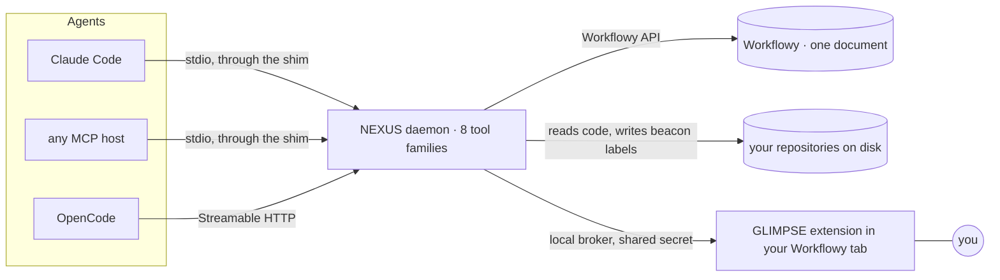

# NEXUS

**Context management you can see.** Workflowy as the shared, living memory of a person and their agents, for knowledge work and for source code.

<sub>MIT · Python 3.10+ · v1.0.1 · an MCP server and a Chrome extension · in daily use</sub>

NEXUS is a Workflowy-native context-management system for agents and humans working together. Workflowy becomes the single shared canvas (projects, decisions, communications, notes), and your source code is mapped live onto it from disk. The agent reads and writes the same tree you see: no copies, no exports, no drift.

**You** never describe context to your agent; you point at it. **Your agent** never guesses at context; it looks.

> 📸 **SCREENSHOT — hero, the shared view:** Chrome, the whole window, 16:9 (about 1600×900). On the left, workflowy.com zoomed into one real documentation subtree with nested sections, for example "🪟 The Docked Markdown Modal" (`ebea800d`, the modal's own manual), its sections expanded. On the right, the docked Markdown modal (the widget's 📌 Dock button) rendering that same subtree as one document: the node list in the top half, the rendered Markdown below it, with the H1 and several H2 sections in view. Privacy: zoom in first so nothing outside that subtree shows, and check the breadcrumb and the widget for work or personal names. Save as `docs/images/hero-shared-view.png`. *Alternative:* a 6–10 second GIF clicking three bullets in turn while the modal re-renders each one as a document.

> 🎬 **VIDEO (optional) — one minute, one idea:** Workflowy on the left, a Claude Code terminal on the right, no narration. (1) Render one NEXUS beacon slice in the modal (as in the beacon-slice shot below): signatures and comments from several files. (2) In the terminal, ask a question the slice answers, starting "GLIMPSE the modal and…"; the agent answers, then calls `beacon.snippet` on one function by name. (3) Cut to that file in an editor, showing the beacon comment above the function: the map lives in the code. Under sixty seconds. Save as `docs/media/one-minute.mp4`, with a GIF preview linked here.

If you already live in Workflowy, NEXUS makes it fully agent-enabled, on both sides you need: your knowledge work and your source code. If you've never used Workflowy, read on anyway. This is the case that, for agents, an outliner is the ideal substrate.

*Built by one person, directing agents. → [Who made this](#who-made-this)*

## At a glance

- **Knowledge work.** Capture into Anchor Docks as you go, cite anything by a permanent handle, select across the whole outline by tags, and render any selection as one Markdown document: for your agent, and in a panel beside your outline.
- **Source code.** Your repositories, mapped into the same outline. Comments kept in the source (*beacons*) become tags, so one call can hand an agent the functions that matter, with their signatures and comments, from a dozen files at once; then it reads any function live from disk, by name.
- **Swarms.** A Manager and a Conductor, whose instructions are themselves Workflowy subtrees, run planning sessions and multi-agent programs through the same tree, on OpenCode and Claude Code.
- **Substance.** About 168,000 lines of first-party code, over 5,400 tests, about 1,300 commits since January 2026; eight MCP tool families with 74 operations; used every day.
- **Built agentically.** Agents wrote the code, with the very system they were building. One person designed it and drove it.

## The idea: nodes are units of memory

Every agent session starts from nothing. Whatever it should know (the plan, the decisions already made, the code that matters, last week's conversation; not too much and not too little) has to be put in front of it, kept current, and handed on to the next agent. The industry now calls this *context engineering*: in Anthropic's words, ["curating and maintaining the optimal set of tokens"](https://www.anthropic.com/engineering/effective-context-engineering-for-ai-agents). It is the defining problem of working with agents, and the real force behind every agent harness.

The standard answer is a curated pile of Markdown files: `CLAUDE.md`, `AGENTS.md`, rules folders, memory folders, notes. It works, and then it sprawls. The files only grow (["the LLM never trims, only amends"](https://news.ycombinator.com/item?id=49945933), as one practitioner put it), they go stale and contradict one another, and which of them a given agent sees is left to file paths, folders or the model's guess. Summaries and compaction aren't the real solution. Curation is, and curation needs a better medium than a folder of files.

NEXUS uses nodes. Every bullet in Workflowy is a unit of memory: a decision, a spec, a meeting recap, a function. Each can hold a full Markdown document, carry tags, and be given a permanent handle (`[ap:K7M2QF]`) that survives moves and renames. Tags cut across the whole outline, so any set of nodes, from anywhere, can be selected and rendered as one document for an agent, and as the same document for you.

> Imagine the nodes out in space. A set of them lights up for one agent; another set lights up for the next. Little dots of light, lighting up and vanishing. **That is context management**, and here you can see it.

> 🎞️ **GIF (optional) — dots of light:** the outline on the left, the modal on the right. Apply three different slice groups in turn from the widget, pressing ⟳ Sync View after each, so that the outline and the modal light up a different set of nodes every time: one tree, three different sets. Use neutral groups only (the demo Dock described in the "agent sees what you see" shot, a reading list, the NEXUS documentation). 8–12 seconds, looping. Save as `docs/images/dots-of-light.gif`.

## Two halves, one canvas: a mirror image

The tools are half knowledge work and half source code, and both halves live in Workflowy. On top of the tools runs an agentic harness with the same two halves, because technical work needs both: planning the work is knowledge work, and doing it is source code.

| | Knowledge work | Source code |
|---|---|---|
| **The tools** (this repository) | Anchor Docks and Anchor Points · slice groups · GLIMPSE and the docked Markdown modal | Cartographer's code map · beacons · beacon slices · live snippets |
| **The harness** (built on the tools) | **Manager Sessions:** an agent that thinks, plans, remembers and curates with you | **The Program Conductor Toolkit:** agentic swarms that plan, write, audit and fix code |

A complete mirror image, all of a piece, and every part of it Workflowy-centric. It's built for people who have to strategize technical work and then get it done: architects, planners, founders, and the non-technical people who end up running technical projects.

## Knowledge work: the view you share

[Workflowy](https://workflowy.com) is an outliner: one document of bullets inside bullets, each with an optional note. With NEXUS, a note can be a whole Markdown document, and any part of the outline can be read as one.

Beside the outline, NEXUS's Chrome extension, GLIMPSE, adds a panel: the **docked Markdown modal**. Point it at something and it renders that as one continuous, clean Markdown document: a single bullet; everything beneath a bullet, however deep; or a slice selected by tags from all over the outline. Headings stay sensible at any depth, tables and code render properly, and the document scrolls on its own while you keep working in the outline.

Your agent asks for the same renders through the MCP tools and gets the same document, from the same composer. That shared document is the bridge everything else stands on:

- **"GLIMPSE this."** The agent reads exactly what you have open (your zoom, your expansions) as one Markdown document. Nothing is copied or pasted.
- **"Render that in the modal."** The agent puts a document in front of you (a Dock, a slice, a search result) without reading it itself. You read; the agent spends next to nothing.
- **"Capture this."** The agent writes what it learned as an Anchor Point in the right Anchor Dock. It's in your outline at once, citable by its handle, readable in the modal.

> 📸 **SCREENSHOT — the agent sees what you see:** two windows side by side. Left: Workflowy zoomed into a small demo Anchor Dock (create one, such as "🚀 Project launch", holding five or six Anchor Points: a short plan, two decisions, a meeting recap, a to-do list, a small table; use it for the next two shots as well, so that no real work appears), three or four bullets expanded and one deliberately collapsed. Right: a Claude Code or OpenCode terminal where you typed "GLIMPSE this", showing the agent's `glimpse(verb='run')` call and the same bullets as Markdown, with nothing from inside the collapsed one. Crop to the two panes. Save as `docs/images/glimpse-this.png`.

> 📸 **SCREENSHOT — a capture lands in your outline:** the same layout. In the terminal, ask the agent to "capture that as a decision under the launch Dock", and show its `anchor(verb='point.capture', …)` call and the acknowledgement carrying the new `[ap:…]` handle. In Workflowy, the new bullet under the demo Dock with its `[ap:…]` prefix visible, and the modal rendering its note. Save as `docs/images/capture.png`.

**Anchor Docks are where things go; slice groups are what you look at.** An Anchor Dock is a named container: a project, a topic, a running log. A slice group is a saved view (a root, a family of tags, a sort), applied by name and rendered as one document. Captures land in Docks as the work happens; views are cut across Docks by tags, whenever you want them. A tag ending in `--expand` pulls a whole subtree into a slice, and one ending in `--deprecated` retires a node without deleting it. Order is yours: move a bullet and every rendered document follows it. "Everything we touched on the launch in the last six hours" is one call.

That's how a context system keeps itself current. Tag a node and it joins the slice it belongs to. A project's map, one small page naming its slices, its code topics and its documentation, is always up to date because everything it names renders live, so every job on the project starts from the same well-chosen material.

> 📸 **SCREENSHOT — a slice group, applied:** the widget open on its Slice Groups section, the green APPLY button visible beside one neutral group (one over the demo Dock, or CARTOGRAPHER DOCS), and the modal showing that applied slice with its ribbon in view (the sort control, ⟳ Sync View, Freeze). Privacy: the Slice Groups list names every group, so crop to two or three safe rows or collapse the categories that hold private groups. Save as `docs/images/apply-slice.png`.

**The gestures, once you know what they're for.** The extension's small widget shows every running job, lists your slice groups (each with an Apply button that renders it into the modal) and keeps an inventory of your Anchor Docks (each with a Render button). A few keys help: F2 and F3 copy a bullet's path and ID to hand to an agent; F8 expands the live outline to show a tag-selected slice; Ctrl+F12 opens the Cartographer menu on a mapped file or folder. Freeze pins the modal's document while you rearrange the outline. All of it is local: the extension reads the page you have open, not the API, and talks to the NEXUS server through a local broker secured by a shared secret.

## Source code: your codebase in the same outline

Cartographer reads a repository from disk and mirrors it into Workflowy: one node per folder, file, class and function, with each function's docstring and comments in its note. Disk stays the source of truth. The map is a projection, refreshed from disk and never edited by hand.

The part that changes how agents work is the **beacon**: a small comment block kept in the source, just above a function that matters.

```python
# @beacon[
#   id=myproj@load_rows,
#   slice_labels=myproj-ingest,
#   kind=ast,
#   comment=Reads one batch of rows and validates them before anything is written.,
# ]
def load_rows(path: str) -> list[dict]:
```

Each label becomes a Workflowy tag. A **beacon slice** is everything that carries a label, rendered as one document: each function's signature, its beacon comment and its docstring, without the bodies. One call hands an agent twenty, thirty, forty functions at once, from a dozen files, with what their authors wrote about them, including the ones in files it would never have thought to search. Then `beacon.snippet` reads any function or class in a mapped file live from disk, by name, numbered like a file read so the agent can edit exactly what it read. The agents that work here are told, in so many words: *when you think "file search", think "slice".*

**Agents keep the beacons, and they're remarkably good at it.** Updating a beacon is part of changing the code, done in the same edit. Told to curate, not carpet-bomb, agents mark the entry points a future agent will look for and leave the thin helpers alone. Because the comments live in the code, documentation and code drift far less, and a fresh agent finds its way around a large codebase quickly. Beacons work in Python, JavaScript and TypeScript, Vue and Markdown, among others.

> 📸 **SCREENSHOT — the code map:** Workflowy showing the NEXUS repository's source map (root `7834ca3d`) expanded down through `src/workflowy_mcp/` to one file (for example `snippet_view.py`), the file expanded to its functions, and one 🔱 beaconed function showing its tags, with its docstring visible in the note. Crop to the outline. Privacy: crop out any absolute disk path in the map root's title. Save as `docs/images/code-map.png`.

> 📸 **SCREENSHOT — a beacon slice:** the modal rendering one NEXUS beacon slice, for example the tag `glimpse-render` (or `slices`) over the source map `7834ca3d`. To get it: zoom Workflowy to the map root with the root collapsed, select its row in the modal's node list, click 🎯 Dyn slice and enter the tag (or ask an agent to push that slice to the modal). Show two or three file headers and several function signatures marked 🔱, each followed by its beacon comment and docstring. Privacy: crop or blur absolute disk paths in the file headers. Save as `docs/images/beacon-slice.png`.

**A thought experiment.** Start from beacons alone: comments on disk, kept by agents, marking the code that matters. Files form a graph, and the functions inside them form another. Once you had that, you would want to see it: browse it, filter it by tag, read a slice as a document, set it beside the plan it serves. You would need a visualization layer, and the ideal one is an outliner with tags. If Workflowy didn't exist, you'd have to write it from scratch.

The beacon half also stands on its own. The **Agent Kit** ([`agent-kit/`](agent-kit/), en route) gives any repository beacon slices and live code reads from disk alone, with no MCP server and no Workflowy.

## Swarms: from one conversation to a program

The tools stand alone, but they were built for something bigger, which runs on them every day: an opinionated agentic harness whose two halves mirror the tools.

**Manager Sessions** is the knowledge-work half: a set of instructions that turns an agent into your *Manager*, the partner you think out loud with, who plans with you, runs programs for you, and remembers. Every conversation gets its own Anchor Dock. What matters is captured as Anchor Points while you talk and curated into topic Docks afterwards, so the next session picks up the thread without your having to reconstruct it. More than two hundred sessions so far.

**The Program Conductor Toolkit** is the source-code half: doctrine for running agentic swarms. A *Conductor* agent plans a program, then writes a **socket** for each worker: an Anchor Point holding that worker's dispatch (its role, what to read, what it may write, what it will be measured against). Workers read code through beacon slices and write their results back into Anchor Points; other agents, often other models, audit them; and when the Conductor's own context fills, it hands off to a fresh session of itself. All of it happens in Workflowy, and the entry point is one line that never changes:

```text
You are the CONDUCTOR. Read [ap:QE4RXD] and follow it.
```

The Toolkit runs knowledge-work programs too. This README began in one: a Conductor wrote a socket for each of six blind authors (three drafts of this README at three thinking levels, three of the Manager App's). One agent did the reading once, the Conductor forked it six times, and each fork wrote its own draft.

> 📸 **SCREENSHOT — a socket:** on the left, the outline showing one program's tree (sockets, ⚖️ RESULTs and 🗣️ For the human children; this portfolio program `[ap:JF1AS0]` will do), and in the modal one worker's socket, for example this README's own `[ap:K333JC]`: its `dispatch:` block (role, inputs, writes, contract) and the start of its prose. Privacy: keep audit reports and steer notes out of view, and check that no visible title names work topics. Save as `docs/images/socket.png`.

**A skill that is a Workflowy subtree.** Neither of these is a file. Both are Workflowy subtrees: rendered in the modal, sliced by tags, cited by handle, and read by progressive disclosure, a section at a time, as the work calls for it. Together they are a well-developed skill for agentic swarm management, and the skill file that loads them is meant to be a few lines long: *load the following publicly available Anchor Point.* Once they're public, copy a subtree and it's yours to adapt. [TODO Dan: link the public copies of both subtrees here once they're shared, with their Markdown exports.]

**The Manager App**, in its own repository, is the cockpit: a desktop and phone app over OpenCode and Claude Code, where you dictate to your Manager, watch every program, Conductor and worker as a live tree, and read Workflowy documents rendered exactly as the modal renders them. It's how Workflowy meets OpenCode and Claude Code for agent swarms. → **[The Manager App README](#)** [TODO Dan: repository name and link]

> 📸 **SCREENSHOT — a swarm, live (Manager App):** the Manager App on the desktop, Programs pane, while a program runs: the Conductor and several workers as a tree, spinners active, each row's status, context and wall-clock time visible (this portfolio program while its authors run, or an MCI unit). Crop to the Programs pane unless the chat pane shows nothing private. Save as `docs/images/manager-app-programs.png`.

> 📸 **SCREENSHOT (optional) — the same document in the cockpit:** the Manager App's View pane rendering the same documentation subtree as the hero shot, to show the cockpit and the modal rendering one document identically. Save as `docs/images/manager-app-view.png`.

## Why Workflowy

Agentic work needs one place that stores everything and that the people working in it can see perfectly. A graph of nodes in one document is both, and Workflowy already is one.

**It's a graph, and it's one document.** Every bullet is a node; every node can hold a whole Markdown document; nodes nest without limit, so a node is a folder and a file at once. Tags cut across the tree. And it is all one document, of a piece, read and written by you and by any number of agents.

**One document is a constraint, and that is its power.** A file system can store anything, which is exactly its problem: which disk, which folder, which copy, who is writing to it right now. It's too powerful to manage. One document is opinionated, and sometimes the constraints are as powerful as the flexibility.

**It does what files can't easily do.**

- Click a node, the equivalent of a folder, and read every "file" beneath it as one continuous document.
- Filter that document by tags, live, without creating a new one.
- Put things in any order you like, by moving a bullet. A file system sorts by name or by date.
- Restructure in a fraction of a second (indent, outdent, drag) while you see the "files" and where they live, both at once.

Files can carry tags in their frontmatter, and good tools can query them. But to hand an agent exactly the set you chose, and to read that set yourself as one live document, you'd end up building something like Workflowy. Why not use Workflowy?

**You can't separate the data from the way people see it.** Cartographer's maps could have lived in SQLite, and faster in-memory maps are on the roadmap. But a map that no human can see is half a system, and a bare schema invites feature creep and then demands a visualization tool anyway. Workflowy is the visualization layer for its own data, and it comes for free. (The in-memory maps, when they arrive, will still be seen in Workflowy.)

**Thousands of nodes is par for the course.** Thousands of Markdown files is sprawl; thousands of nodes in Workflowy is the sign of a healthy system. Docks hold them, slice groups cut across them, and moving one is a drag of the mouse. When a branch is finished, NEXUS can export it to a verified archive file; delete it from the outline, and agents can still read, search and render it.

**And it's all still Markdown.** Every note is Markdown, renders as Markdown, and exports to disk whenever you want files. Nodes behave like documents without the weight of files.

For well over a decade, Workflowy has been one of the best tools there is for thinking in outline. It turns out to be more than that: the ideal substrate for context management in the agentic age, for knowledge work, for source code, and for the swarms that do both. This isn't just a system that uses Workflowy. It's a system that needs it.

> **If Workflowy didn't exist, it would have to be invented.**

## What's already out there

The premise isn't new, and neither are all the pieces. Fairly stated:

- **Curated instruction files** (`CLAUDE.md`, `AGENTS.md`, rules folders, skills) are the industry's answer, loaded in stages by progressive disclosure. NEXUS shares the premise, *curate the context*, and changes the medium: the curated units are nodes you can see, reorder and select across, not files gathered by path.
- **Built-in memory** (ChatGPT, Claude and Gemini; Claude Code's auto-memory; Codex's memories) is synthesized for you and often only partly visible. Here, memory is written in the open, as bullets you read, edit and move.
- **Outliners with MCP servers.** Workflowy now ships its own desktop MCP server, which lets an agent read and update your outline, and Tana offers one, in alpha, over its nodes and supertags. Agent access to an outliner isn't the news. What NEXUS builds on that access is: permanent handles, tag-defined selections rendered as one document for agent and human alike, the docked modal, the code map, and a harness that runs swarms through all of it.
- **Agent-memory systems**, such as Letta's git-backed Markdown "context repositories" and the knowledge-graph memory servers, share memory across agents, and Letta adds git history, which an outline lacks. What they don't put first is a human view in which the selection itself is visible.
- **Obsidian** is a fantastic Markdown tool, with links, transclusions and queries. It is still files in folders.

The trade-offs are real: Workflowy is a hosted service with API rate limits, and none of this works without NEXUS running beside it. And no one, this project included, has published numbers showing that tag-selected context beats well-curated files. The claim here is about the shape of the work, and it rests on daily use, not on a benchmark.

## Who made this

Not a company. One person.

I'm Dan Nissenbaum. I was a principal at Microsoft for five years, an individual contributor, and I've been building software for decades: never that active in open source, incredibly active in private source. I'm not a good marketer. I've been holed up, working non-stop with these agentic systems, finding the ways to make them work best, and this is what I've landed on. I've got something I'd like to share now.

**Agents wrote the code**, all 168,000-odd lines of it; I wrote almost none. I drove every idea, insisted on good design and kept the work moving, and the agents did the programming, more and more of it with the system they were building. In terms of the humans involved, it's a hundred percent me. That isn't a confession; it's the point. This is a fully agentic system, built agentically, and version one is locked and sealed.

It doesn't wrap anyone's framework. The one starting point that wasn't mine was a minimal example Workflowy MCP server, [vladzima/workflowy-mcp](https://github.com/vladzima/workflowy-mcp) [CONFIRM Dan: vladzima/workflowy-mcp]: a real help on day one, and about one percent of what's here.

I'll say one thing plainly, once: I think this is the best paradigm there is for working with agents. If you look at it and find you have something to say about it, I'd like to hear from you. [TODO Dan: contact link]

## Under the hood

What engineers usually ask about:

- **One daemon, many hosts.** One NEXUS daemon per machine serves every agent. Hosts that speak stdio attach through a small shim that starts the daemon on first use; HTTP-native hosts (OpenCode, for one) dial it directly. It runs natively on Windows, macOS and Linux.
- **One broker, many tabs.** The Chrome extension connects through a local broker that requires a shared secret. With several Workflowy tabs open, an agent can target one by name.
- **Coherence.** Server-side reads come from a managed mirror of the whole Workflowy document. Writes are checked against live Workflowy before and after, and journaled, so many agent sessions stay consistent with one document.
- **Governed bulk writes.** A map refresh rewrites many nodes, so an account-wide write governor and a breaker pace it. They exist because over-eager refreshes once locked the account out of writes, and the tool descriptions now warn every agent about it, in capital letters.
- **Export archives.** Finished subtrees move into verified archive files and stay readable, searchable and renderable, marked 📦.
- **Tests.** Over 5,400 test functions.



## The tools explain themselves

You don't need a skill file to start: the tools are the skill. Their own descriptions teach the system: a server description, eight always-on family descriptions (the whole surface is about 44,500 characters, roughly 11,000 tokens: 61% smaller than the forty-odd tools it replaced) and progressive disclosure for everything else. `describe` on a family lists its operations; `describe` on one operation returns its full manual; a failed call returns that manual along with the error.

| Family | What it's for |
|---|---|
| `node` | Read, search, edit and create nodes. Every note is a Markdown document, read and edited like a file. |
| `anchor` | Anchor Docks and Anchor Points: capture, peek, render, cite, and promote with provenance. |
| `glimpse` | Render anything as Markdown: the live view, the modal, a subtree, a slice group, a saved selection. |
| `slice_group` | Saved views and lenses (union, intersection, difference); `sift` searches inside one. |
| `lightning_rod` | Temporary selections by tag, by text search or by symbol. |
| `beacon` | Mapped code: read any symbol live from disk, keep beacon labels, refresh the map. |
| `tag` | Add, remove and rename tags, one at a time or in batches. |
| `system` | Health, the cache, jobs, export archives. |

Every call has one shape, `family(verb=…, params={…})`, and handles are uniform: a permanent `[ap:…]` ID, a UUID, or just its first eight hex characters, wherever a node is expected. An illustrative session:

```text
you    GLIMPSE this.
agent  glimpse(verb='run')
       → exactly what you have open, as one Markdown document

you    Capture that as a decision under the launch Dock.
agent  anchor(verb='point.capture', params={'parent_handle': '[ap:K7M2QF]',
              'name': 'Decision: the beta ships in March', 'content': '…', 'ap_id': 'auto'})
       → a new Anchor Point, with its own [ap:…] handle, in your outline

you    Put everything we touched on the launch in the last six hours in my modal.
agent  glimpse(verb='run', params={'group_handle': 'Project Launch', 'recent': '6h',
              'push_to_modal': True})
       → rendered in your modal; the agent never reads it

you    Where do we validate incoming rows?
agent  slice_group(verb='sift', params={'lens': {'tags': ['myproj-ingest'], 'root': '‹code map›'},
              'query': 'validate'})
agent  beacon(verb='snippet', params={'source_handle': 'load_rows'})
       → the function, live from disk, line-numbered
```

## Components and status

| Component | What it is | Status |
|---|---|---|
| **NEXUS MCP server** · `src/workflowy_mcp/` | The daemon and its eight tool families | Working, in daily use · v1.0.1 |
| **Cartographer and beacons** | The code map, beacon slices, live snippets | Working, in daily use |
| **GLIMPSE Chrome extension** · `workflowy-glimpse-cache/` | The live view, the docked Markdown modal, the widget, the hotkeys | Working, in daily use · installed unpacked · a redesigned interface is next |
| **Agent Kit** · `agent-kit/` | Beacon slices and live code reads from disk alone, without Workflowy | En route: built and tested here, not yet used elsewhere |
| **Skill file and public subtrees** | A few-line skill that loads a public Workflowy subtree | Planned |
| **Manager Sessions** · a Workflowy subtree | The Manager's instructions | Working, in daily use · written for my own setup |
| **Program Conductor Toolkit** · a Workflowy subtree | Doctrine for running agentic swarms | Working, in daily use · written for my own setup |
| **Manager App** · its own repository | The desktop and phone cockpit over OpenCode and Claude Code | Working, in daily use on my machine |

The details of each component, what it needs, and where to read more: **[COMPONENTS.md](COMPONENTS.md)**.

## Trying it

NEXUS is used every day, but so far on one person's machines; easy installation is next on the roadmap. Today you need:

- a **Workflowy account** and its API key;
- **Python 3.10+** and [uv](https://docs.astral.sh/uv/);
- an **MCP host**: Claude Code, OpenCode, Claude Desktop, or anything else that speaks MCP over stdio or Streamable HTTP;
- for the visual half, **Chrome 111+**, with the extension loaded unpacked from [`workflowy-glimpse-cache/`](workflowy-glimpse-cache/).

A typical MCP host entry:

```json
{
  "mcpServers": {
    "workflowy": {
      "command": "uvx",
      "args": ["--from", "git+https://github.com/daniel347x/workflowy-nexus-mcp-tools.git", "workflowy-mcp"],
      "env": { "WORKFLOWY_API_KEY": "<your Workflowy API key>" }
    }
  }
}
```

The first call starts the local daemon on `127.0.0.1:8766`; HTTP-native hosts can connect to `http://<host>:8766/mcp` with its bearer token instead. The daemon runs natively on Windows, macOS or Linux; from inside WSL, connect to the daemon running on Windows. The extension asks once, on its options page, for the broker's shared secret. More: [`workflowy-glimpse-cache/INSTALL.md`](workflowy-glimpse-cache/INSTALL.md) and [`CONFIG_REFERENCE.md`](CONFIG_REFERENCE.md).

[TODO Dan: run this quick start end to end on a clean machine before publishing; INSTALL.md still describes an older extension version.]

## What's next

Version one is locked and sealed. Next:

- a redesigned extension interface, and short videos of all of the above;
- easy installation, including the Chrome Web Store;
- the skill file, and generic public copies of the Manager and Conductor subtrees;
- the Agent Kit's hardening pass;
- code maps held in memory, for worktrees and for speed, still seen in Workflowy.

## License and credits

MIT; see [LICENSE](LICENSE). NEXUS began from a minimal example Workflowy MCP server, [vladzima/workflowy-mcp](https://github.com/vladzima/workflowy-mcp) [CONFIRM Dan: vladzima/workflowy-mcp; if confirmed, carry its MIT notice as that license asks]. It is an independent project, not affiliated with Workflowy.
